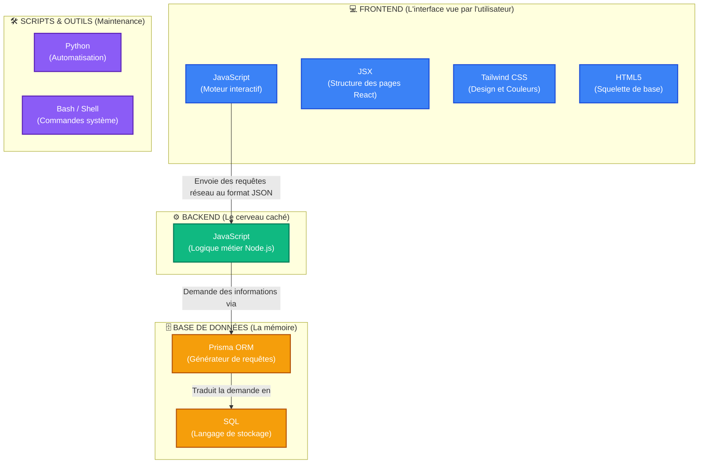

# 🚀 Cartographie des Langages - Mylta Academy

> [!TIP]
> **Comment lire ce document ?**
> Plutôt que de longues explications, ce document utilise des schémas visuels pour vous montrer **exactement** où chaque langage de programmation intervient dans la plateforme.

---

## 🗺️ 1. Schéma Visuel de la Plateforme (Vue d'ensemble)

Voici la répartition visuelle des langages par "zone" de l'application. Les cases représentent les technologies et comment elles sont connectées.

---

## 🔍 2. Explication Simple de Chaque Case

Voici ce que fait concrètement chaque technologie que vous voyez dans le schéma ci-dessus.

> [!NOTE] 
> **Le saviez-vous ?**
> Le langage **JavaScript** est le grand gagnant ici. C'est le seul langage qui est utilisé *à la fois* pour créer l'interface visible (Frontend) et pour faire tourner le serveur (Backend).

### 💻 Dans la partie "Frontend" (Ce que voit l'utilisateur)

* **JavaScript** : Donne vie aux boutons, aux lecteurs vidéo et gère l'envoi de données sans recharger la page.
* **JSX** : C'est un code hybride (mélange de JavaScript et HTML) utilisé par le framework React pour construire vos pages (`.jsx`).
* **Tailwind CSS** : C'est ce qui rend l'application jolie. Ce ne sont pas des fichiers CSS classiques, mais des petits mots-clés (ex: `bg-blue-500`) écrits directement dans le code JSX.
* **HTML5** : Il n'y a qu'un seul vrai fichier HTML (`index.html`) qui sert de point d'entrée pour charger tout le reste.

### ⚙️ Dans la partie "Backend" (Le cerveau)

* **JavaScript (Node.js)** : Ici, JavaScript n'interagit pas avec des boutons, mais gère la sécurité, vérifie les mots de passe, gère les paiements et décide qui a le droit de voir quelle vidéo.

### 🗄️ Dans la partie "Base de données"

* **SQL** : Le langage officiel pour parler à la base de données (SQLite ou PostgreSQL).
* **Prisma** : C'est un "traducteur". Au lieu que vous écriviez du code SQL complexe et difficile à lire, vous demandez les données en JavaScript à Prisma, et Prisma écrit le SQL pour vous.

### 🛠️ Dans la partie "Scripts & Maintenance"

* **Python** : Utilisé pour de petits robots (scripts) placés à la racine du projet qui font des tâches répétitives (ex: `replace_currency.py` pour changer toutes les devises d'un coup).
* **Bash** : Utilisé pour des commandes exécutées dans le terminal (ex: pour lancer des tests de sécurité du serveur).

---

## 📊 3. Résumé Express

| Si vous voulez modifier... | Vous devez toucher au langage... |
| :--- | :--- |
| **Les couleurs, le design, l'apparence** | Tailwind CSS / JSX |
| **Ce qui s'affiche à l'écran (texte, boutons)** | JSX / JavaScript (React) |
| **Les prix, la vérification des comptes, les mails** | JavaScript (Node.js) |
| **L'organisation des tables en base de données** | Schéma Prisma |
| **Des scripts de maintenance de masse** | Python |
